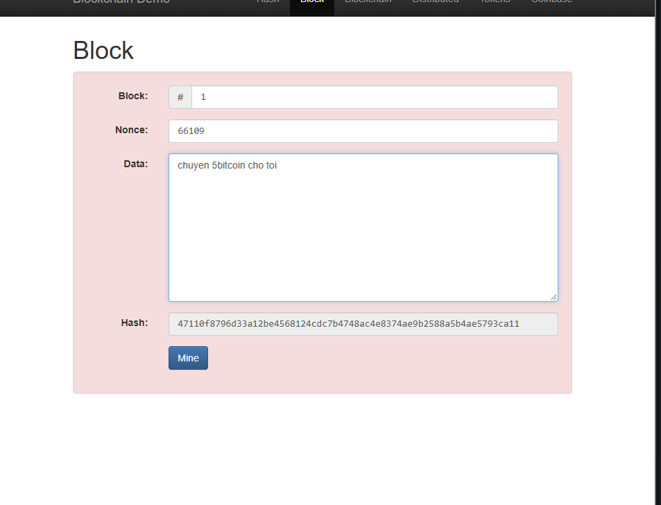
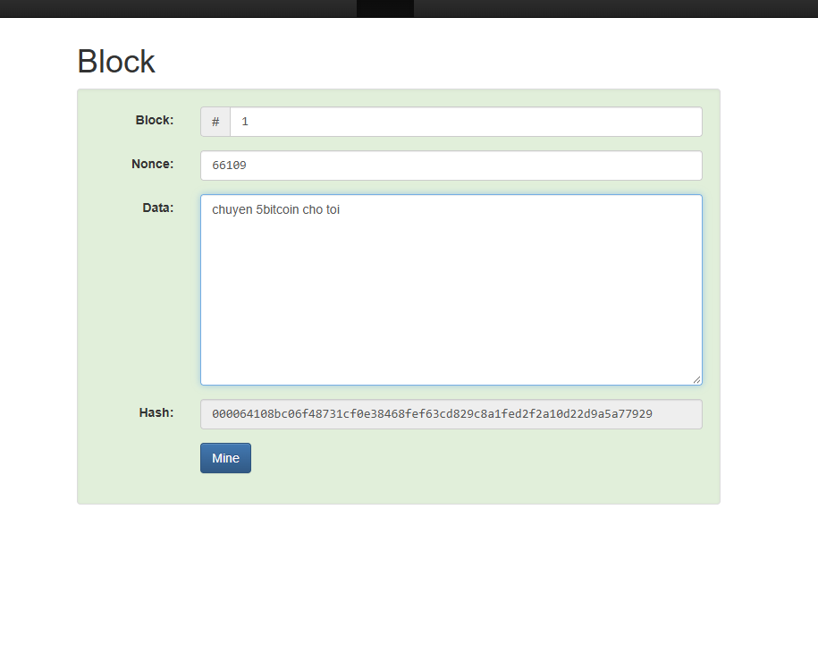

# Session 01 - Blockchain Fundamentals

- Student: Nguyen Xuan Dai
- GitHub: [@dainx06](https://github.com/dainx06)
- Submitted: 2026-10-21
- Commit: https://github.com/dainx06/dev-lock-bootcamp/commit/ea86d9df0758dc772fc110f7fabdaa20d3454460

## 1. Summary
*Khái niệm: Công nghệ cơ sở dữ liệu phân tán, lưu trữ dữ liệu trong các block liên kết bằng mã hash, giúp dữ liệu minh bạch và khó bị sửa đổi
Block: Khối dữ liệu chứa thông tin hoặc giao dịch.
Chain: Chuỗi các block liên kết qua mã hash.
Node: Các máy tính tham gia lưu trữ, xác thực và duy trì mạng lưới.
*Bản chất:
Liên kết bằng mã hash giúp phát hiện sự thay đổi dữ liệu.
Dùng Cơ chế đồng thuận (Consensus) để các nút thống nhất trạng thái dữ liệu.
Giúp tăng khả năng kiểm chứng và giảm phụ thuộc vào bên trung gian.
Mô hình tập trung (Centralized): Quyền quản lý và kiểm soát dữ liệu thuộc về một tổ chức (ví dụ: ngân hàng).
Mô hình phi tập trung (Decentralized): Quyền xác thực được phân phối giữa nhiều nút mạng, giảm sự phụ thuộc vào bên trung gian.

## 2. Topic notes
Blockchain liên kết các block bằng mã hash, giúp minh bạch và phát hiện sự thay đổi dữ liệu.   Cơ chế đồng thuận (Consensus) giúp các nút mạng thống nhất trạng thái dữ liệu mà không cần bên trung gian.   Mô hình quản lý chia thành tập trung (do một tổ chức kiểm soát) và phi tập trung (quyền xác thực chia đều cho các nút).   Blockchain không đồng nghĩa với tiền mã hóa; tiền mã hóa chỉ là một trong những ứng dụng.   Bitcoin là ứng dụng tiêu biểu tập trung vào giao dịch tài sản số phi tập trung, giúp giảm phụ thuộc vào trung gian nhưng không đảm bảo an toàn tuyệt đối và hạn chế về tính năng so với Ethereum

## 3. Work completed

## 4. Evidence

## 5. Blockers

## 6. Takeaway

